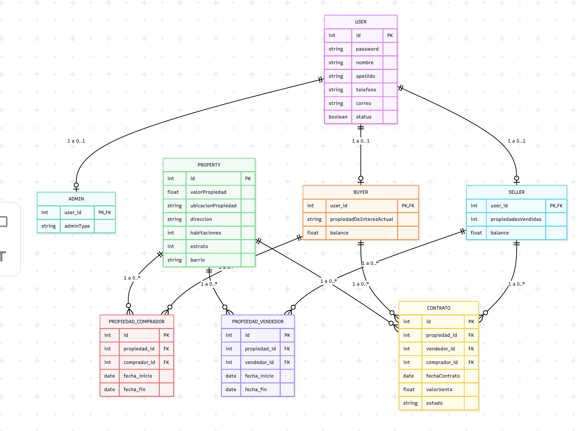

<!--
  GUÍA RÁPIDA PARA AGREGAR TUS CAPTURAS (este bloque no se ve en GitHub, puedes borrarlo al final)

  1. En la raíz del repositorio crea la carpeta:  docs/img
  2. Guarda tus capturas ahí con nombres en minúscula, sin espacios ni tildes
     (ejemplo: postman-post-clientes.png).
  3. Busca en este archivo el emoji 📸 (Ctrl+F). Cada uno marca un lugar donde va una captura.
  4. Debajo de cada 📸 hay una línea de imagen dentro de un comentario:
     quita las marcas de comentario (la apertura y el cierre) para activarla.
  5. Si quieres controlar el tamaño, cambia la línea por:
     
  6. Haz commit de la carpeta docs/img junto con el README, si no, la imagen sale rota.
-->

<div align="center">

# 🏠 Manuela Bermudez Reaktor

**Backend de la inmobiliaria: lógica de negocio, base de datos y API REST**


Proyecto integrador · 3.er semestre · Técnico en Desarrollo de Software · **CESDE**

</div>

<!-- 📸 CAPTURA OPCIONAL (portada): logo del proyecto o pantallazo de Swagger UI.

-->

---

## 📑 Tabla de contenido

- [📖 Descripción](#-descripción)
- [🧱 Arquitectura](#-arquitectura)
- [📋 Requisitos previos](#-requisitos-previos)
- [🚀 Instalación y configuración](#-instalación-y-configuración)
- [🔧 Configuración interna](#-configuración-interna)
- [🔌 Endpoints](#-endpoints)
- [🧪 Pruebas unitarias](#-pruebas-unitarias)
- [📚 Documentación con Swagger](#-documentación-con-swagger)
- [📜 Licencia y derechos de autor](#-licencia-y-derechos-de-autor)
- [👥 Autores](#-autores)

---

## 📖 Descripción

Backend para la inmobiliaria **Manuela Bermudez Reaktor**. Este proyecto concentra:

- 🗂️ La lógica de las tablas y sus relaciones.
- 🗄️ La conexión a la base de datos.
- ✏️ El CRUD completo de las entidades.
- 🔗 La comunicación con el front a través de una API REST.

Fue desarrollado como **proyecto integrador del tercer semestre** de la técnica en Desarrollo de Software en CESDE.

---

## 🧱 Arquitectura

El proyecto usa una **arquitectura por capas**, donde cada capa tiene una única responsabilidad:

| Capa              | Responsabilidad                                                      |
| ----------------- | -------------------------------------------------------------------- |
| 🏷️ **Entity**     | Representa las entidades con sus atributos y relaciones.             |
| 💾 **Repository** | Gestiona el acceso a los datos.                                      |
| 🧠 **Service**    | Contiene las reglas de negocio.                                      |
| 🌐 **Controller** | Recibe las solicitudes HTTP y devuelve las respuestas.               |
| 📦 **DTO**        | Objetos que definen qué datos viajan entre el cliente y el servidor. |
| 🔄 **Mapper**     | Convierte entre `Entity` y `DTO`.                                    |

```text
Cliente (Front / Postman)
        │  HTTP
        ▼
   Controller  ──►  Service  ──►  Repository  ──►  MySQL
        ▲              │
        └── DTO ◄── Mapper
```

### 🛠️ Tecnologías

| Componente                  | Tecnología        |
| --------------------------- | ----------------- |
| Lenguaje                    | Java              |
| Framework                   | Spring Boot       |
| Base de datos               | MySQL (XAMPP)     |
| Herramienta de construcción | Maven             |
| Documentación de la API     | Swagger (OpenAPI) |

### 📦 DTO y Mapper

<!-- TODO: documenta aquí tus DTO y Mappers reales. Por ejemplo:
- Qué DTO tienes (nombre y para qué se usa).
- Si el Mapper es manual o usa MapStruct.
- Un ejemplo corto de conversión Entity → DTO.
-->

> ✍️ **Pendiente:** describir los DTO y Mappers del proyecto (nombre, propósito y un ejemplo corto).

### 🗺️ Estructura del proyecto

<!-- Ajusta los nombres de paquetes y clases a los de tu proyecto. -->

```text
src/main/java/<tu.paquete>/
├── controller/    # Endpoints REST
├── service/       # Reglas de negocio
├── repository/    # Acceso a datos (JPA)
├── entity/        # Entidades y relaciones
├── dto/           # Objetos de transferencia
└── mapper/        # Conversión Entity ↔ DTO
```

📸 CAPTURA: modelo entidad-relación de la base de datos.



---

## 📋 Requisitos previos

Antes de empezar, asegúrate de tener instalado:

| Requisito      | Versión mínima                                          | Para qué sirve                     |
| -------------- | ------------------------------------------------------- | ---------------------------------- |
| ☕ **JDK**     | 17 o superior (verifica `java.version` en tu `pom.xml`) | Compilar y ejecutar la aplicación  |
| 📦 **Maven**   | 3.8+ (o el wrapper `mvnw` incluido)                     | Gestionar dependencias y construir |
| 🗄️ **MySQL**   | 8+ / MariaDB (incluido en **XAMPP**)                    | Base de datos                      |
| 🧰 **IDE**     | IntelliJ IDEA (recomendado)                             | Desarrollo                         |
| 📮 **Postman** | Cualquiera                                              | Probar los endpoints               |

### 🔐 Variables de entorno (opcional)

Si no quieres dejar credenciales en el código, puedes definirlas como variables de entorno:

| Variable      | Descripción                    | Valor por defecto                         |
| ------------- | ------------------------------ | ----------------------------------------- |
| `DB_URL`      | URL de conexión JDBC           | `jdbc:mysql://localhost:3306/<nombre_bd>` |
| `DB_USER`     | Usuario de la base de datos    | `root`                                    |
| `DB_PASSWORD` | Contraseña de la base de datos | _(vacía en XAMPP)_                        |
| `JAVA_HOME`   | Ruta del JDK instalado         | —                                         |

---

## 🚀 Instalación y configuración

### 1️⃣ Clonar el repositorio

```bash
git clone https://github.com/<usuario>/<repositorio>.git
cd <repositorio>
```

### 2️⃣ Configurar la base de datos

1. Abre **XAMPP** e inicia los módulos **Apache** y **MySQL**.
2. Entra a [`http://localhost/phpmyadmin`](http://localhost/phpmyadmin).
3. Crea una base de datos nueva con cotejamiento `utf8mb4_general_ci`.

<!-- 📸 CAPTURA: XAMPP con Apache y MySQL en verde (Running).
     Guárdala como docs/img/xampp-activo.png


-->

<!-- 📸 CAPTURA: phpMyAdmin con la base de datos y sus tablas creadas.
     Guárdala como docs/img/phpmyadmin-bd.png


-->

> 💡 Con `spring.jpa.hibernate.ddl-auto=update`, Spring Boot crea y actualiza las tablas automáticamente al iniciar.

### 3️⃣ Configurar las variables de entorno

Edita `src/main/resources/application.properties`:

```properties
# Conexión a MySQL (XAMPP)
spring.datasource.url=${DB_URL:jdbc:mysql://localhost:3306/<nombre_bd>}
spring.datasource.username=${DB_USER:root}
spring.datasource.password=${DB_PASSWORD:}

# JPA / Hibernate
spring.jpa.hibernate.ddl-auto=update
spring.jpa.show-sql=true

# Servidor
server.port=8080
```

> ⚠️ Reemplaza `<nombre_bd>` por el nombre real de tu base de datos.

### 4️⃣ Ejecutar las pruebas

```bash
./mvnw test
```

### 5️⃣ Iniciar el aplicativo

**Desde la terminal:**

```bash
./mvnw spring-boot:run
```

**Desde IntelliJ:** abre la clase principal (la que tiene `@SpringBootApplication`) y presiona ▶️ **Run**.

Si todo salió bien, verás en consola un mensaje parecido a:

```text
Tomcat started on port 8080 (http)
Started <NombreApplication> in X seconds
```

<!-- 📸 CAPTURA: consola de IntelliJ con la aplicación iniciada correctamente.
     Guárdala como docs/img/consola-arranque.png


-->

---

## 🔧 Configuración interna

| Elemento                          | Valor                                 |
| --------------------------------- | ------------------------------------- |
| 🌍 URL base de la API             | `http://localhost:8080`               |
| 🔌 Puerto de la aplicación        | `8080`                                |
| 🗄️ Servidor MySQL                 | `localhost:3306`                      |
| 🖥️ phpMyAdmin                     | `http://localhost/phpmyadmin`         |
| 👤 Usuario de la base de datos    | `root`                                |
| 🔑 Contraseña de la base de datos | _(vacía, valor por defecto de XAMPP)_ |

> ⚠️ Estas credenciales son **solo para desarrollo local**. Nunca subas contraseñas reales al repositorio.

---

## 🔌 Endpoints

URL base: `http://localhost:8080`

### 👤 Clientes

| Método | Ruta                    | Anotación                     | Descripción                               |
| :----: | ----------------------- | ----------------------------- | ----------------------------------------- |
| `POST` | `/clientes`             | `@PostMapping`                | ➕ Adiciona un registro de cliente        |
| `GET`  | `/clientes/{idcliente}` | `@GetMapping("/{idcliente}")` | 🔍 Consulta un cliente por llave primaria |

<!-- TODO: agrega aquí el resto de endpoints con el mismo formato, por ejemplo:
| `GET` | `/clientes` | `@GetMapping` | 📋 Lista todos los clientes |
| `PUT` | `/clientes/{idcliente}` | `@PutMapping("/{idcliente}")` | ✏️ Actualiza un cliente |
| `DELETE` | `/clientes/{idcliente}` | `@DeleteMapping("/{idcliente}")` | 🗑️ Elimina un cliente |
Copia el mismo bloque (título + tabla) para las demás entidades (inmuebles, propietarios, etc.).
-->

### 📮 Ejemplo de petición

**`POST /clientes`**

```json
{
  "idcliente": "101010",
  "nomcliente": "Nombre de ejemplo",
  "dircliente": "Dirección de ejemplo",
  "telcliente": "3000000000",
  "activo": "si"
}
```

> 🔁 Cambia los campos por los de tu entidad real.

<!-- 📸 CAPTURA: Postman con el POST y la respuesta (201 Created).
     Deben verse la URL, el body JSON y el código de estado.
     Guárdala como docs/img/postman-post-clientes.png


-->

<!-- 📸 CAPTURA: Postman con el GET por id y la respuesta (200 OK).
     Guárdala como docs/img/postman-get-cliente.png


-->

<!-- 📸 CAPTURA: phpMyAdmin con el registro ya guardado en la tabla (prueba de que persiste).
     Guárdala como docs/img/phpmyadmin-registro.png


-->

---

## 🧪 Pruebas unitarias

Las pruebas usan **JUnit 5** y **Mockito**, incluidos en `spring-boot-starter-test`.

**Ejecutar todas las pruebas:**

```bash
./mvnw test
```

**Ejecutar una clase de pruebas específica:**

```bash
./mvnw -Dtest=NombreDeLaClaseTest test
```

Las pruebas están en `src/test/java/<tu.paquete>/`.

<!-- TODO: documenta brevemente qué pruebas tienes (por ejemplo: ClienteServiceTest) y qué cubren. -->

<!-- 📸 CAPTURA: resultado de las pruebas en verde (IntelliJ o consola de Maven con BUILD SUCCESS).
     Guárdala como docs/img/tests-ok.png


-->

---

## 📚 Documentación con Swagger

La API se documenta con **Swagger (OpenAPI)** mediante la librería `springdoc-openapi`.

**1. Agrega la dependencia en el `pom.xml`:**

```xml
<dependency>
    <groupId>org.springdoc</groupId>
    <artifactId>springdoc-openapi-starter-webmvc-ui</artifactId>
    <version><!-- usa la versión compatible con tu Spring Boot --></version>
</dependency>
```

> ⚠️ Revisa la [documentación de springdoc](https://springdoc.org/) para elegir la versión compatible con tu versión de Spring Boot.

**2. Inicia la aplicación y abre:**

| Recurso                          | URL                                           |
| -------------------------------- | --------------------------------------------- |
| 🖥️ Interfaz Swagger UI           | `http://localhost:8080/swagger-ui/index.html` |
| 📄 Especificación OpenAPI (JSON) | `http://localhost:8080/v3/api-docs`           |

<!-- 📸 CAPTURA: pantalla principal de Swagger UI con la lista de endpoints.
     Guárdala como docs/img/swagger-ui.png


-->

---

## 📜 Licencia y derechos de autor

Proyecto académico desarrollado en **CESDE**. © 2026 — Todos los derechos reservados a sus autores.

<!-- TODO: si el repositorio va a ser público, elige una licencia (por ejemplo MIT), agrega un archivo LICENSE en la raíz y actualiza esta sección. -->

---

## 👥 Autores

| Nombre                       | Rol                     | GitHub                                                             |
| ---------------------------- | ----------------------- | ------------------------------------------------------------------ |
| Andrés Felipe Orozco Loaiza  | Desarrollador BackEnd   | [@budweiker](https://github.com/budweiker)                         |
| Santiago Rodriguez Fernandez | Desarrollador FullStack | [@santiagorodri7](https://github.com/santiagorodri7)               |
| Weimar Tuberquia             | Desarrollador FrontEnd  | [@weimartuberquia609-wq](https://github.com/weimartuberquia609-wq) |
| Alex Ramirez Herrera         | Desarrollador FrontEnd  | [@Alex-2204](https://github.com/Alex-2204)                         |

---

<div align="center">

Hecho con ☕ y mucho código · CESDE · 2026

</div>
